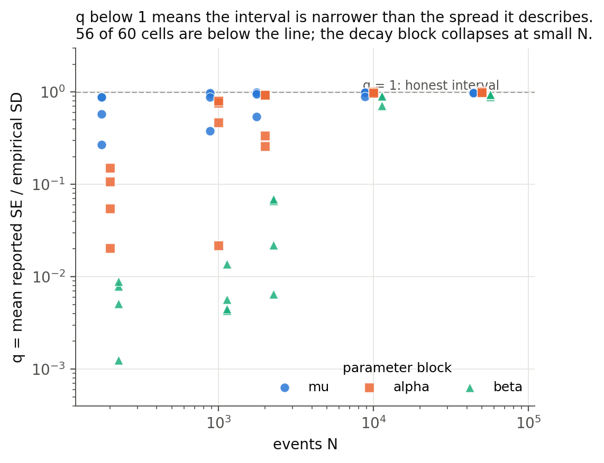
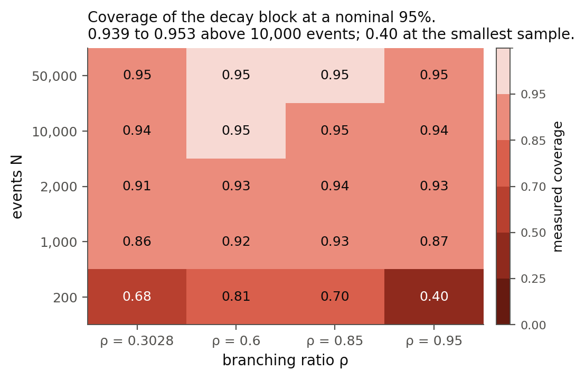

# hawkes-engine

[](https://pypi.org/project/hawkes-engine/)
[](https://github.com/freddysccheung-067/hawkes-engine/actions/workflows/test.yml)
[](https://pypi.org/project/hawkes-engine/)
[](LICENSE)
[](https://doi.org/10.5281/zenodo.23613789)

Multivariate Hawkes processes with exponential kernels, for Python. A compiled
likelihood and gradient, a maximum-likelihood fit that returns standard errors, two
independent exact simulators, and time-rescaling diagnostics.

Every library of this kind hands you a standard error. Almost none of them tell you
what that number is worth. This one does, because a pre-registered simulation study
was run first and its answer is uncomfortable: **the standard errors this fit reports
are too small.** Over 128 simulation cells and 2000 replications each, the mean
reported standard error is 0.779 of the true sampling spread. The number is on the
front page rather than in an appendix, and the same measurement ships as a lookup you
can call on your own data.

## Install

```bash
python -m pip install hawkes-engine
```

Version 0.2.0. Wheels for CPython 3.10 to 3.12 on Linux x86-64, macOS (x86-64 and
arm64) and Windows AMD64. Building from source needs a C++20 compiler and CMake 3.24;
[docs/install.md](docs/install.md) has the commands for each platform.

0.2.0 adds `se_method="auto"`: the fit consults a pre-registered calibration study
and, where the study measured that the inverse-Hessian interval is too narrow in that
regime, reports a bootstrap interval instead, saying which it used and why. Where the
study has no measurement it keeps the Hessian interval and labels it uncalibrated;
where it says the estimator is undefined it reports no interval. The default is still
`"hessian"`, which is what the calibration study measured.

## A fit in a few lines

```python
import numpy as np
import hawkes_engine as he

mu = np.array([0.6, 0.9])
alpha = np.array([[0.10, 0.35], [0.20, 0.05]])  # row = target, column = source
beta = np.array([[1.30, 1.70], [1.30, 1.70]])

times, types = he.simulate(mu, alpha, beta, T=20000.0, seed=1)
fit = he.fit(times, types, M=2, T=20000.0, seed=1)

print(fit.alpha.round(3))            # excitation weights
print(fit.se["alpha"].round(3))      # reported standard errors
print(fit.rho)                       # spectral radius of the branching matrix
print(fit.se_source)                 # "hessian", "bootstrap" or "none"
```

Rows are targets and columns are sources: `alpha[i, j]` is the excitation a type-`j`
event applies to type `i`. The fit returns parameters, standard errors, the branching
matrix, its spectral radius, and a conditioning verdict.

## The finding

<p align="center">
  
</p>

Each point is one cell of the study: the mean reported standard error divided by the
empirical standard deviation of the estimate across 2000 replications. A value of 1
means the interval is honest. 56 of 60 cells sit below the line. The baselines and
excitation weights are close to it; the decay rates are not, and they collapse at
small samples. The y-axis is logarithmic and the lowest points are three orders of
magnitude off.

<p align="center">
  
</p>

Coverage says the same thing in the units a user actually feels. At 10 000 events and
above, a nominal 95 percent interval covers between 0.939 and 0.953, which is usable.
At 200 events against a branching ratio of 0.95, it covers 0.40.

| Measured, two types, 2000 or more events | Value |
|---|---|
| Pooled ratio of reported SE to empirical SD | **0.779 ± 0.011** |
| Same, baseline block | 0.936 |
| Same, excitation block | 0.869 |
| Same, decay block | **0.61** |
| Median-based companion, insensitive to the tail | 0.983 ± 0.003 |

The shortfall is concentrated in the tail rather than spread evenly: a median-based
companion that ignores it comes out at 0.983, while the mean-based ratio does not. The
practical reading is that a reported standard error from this release is a lower bound
on the uncertainty, not the uncertainty.

## Ask it about your own fit

The study is not only prose. `trust_lookup` answers from the nearest of the 128
measured cells and returns what that cell measured:

```python
import numpy as np
import hawkes_engine as he

mu = np.array([0.6, 0.9])
alpha = np.array([[0.10, 0.35], [0.20, 0.05]])
beta = np.array([[1.30, 1.70], [1.30, 1.70]])
times, types = he.simulate(mu, alpha, beta, T=20000.0, seed=1)
fit = he.fit(times, types, M=2, T=20000.0, seed=1)

answer = he.trust_lookup(N=len(times), rho_hat=fit.rho, beta=fit.beta.min(), T=20000.0)
print(answer.status)                    # "measured", "unknown", or "estimator undefined in this regime"
print(answer.coverage["beta"])          # measured coverage of nominal-95 intervals, and its MC SE
print(answer.q["beta"])                 # reported SE over empirical SD, and its bootstrap SE
```

Outside the measured box it says `unknown` rather than interpolating a number that was
never measured. Where the estimator does not exist it says so.

## Let the measurement choose the interval

0.2.0 turns that lookup into a fitting option. The default is still `"hessian"`, which
costs nothing extra and is the method the study measured. `se_method="auto"` consults
the map instead, and where the map says the inverse-Hessian interval is too narrow in
that regime, it reports a parametric bootstrap interval, refitting the model 200
times.

```python
import numpy as np
import hawkes_engine as he

mu = np.array([0.6, 0.9])
alpha = np.array([[0.10, 0.35], [0.20, 0.05]])
beta = np.array([[1.30, 1.70], [1.30, 1.70]])
times, types = he.simulate(mu, alpha, beta, T=20000.0, seed=1)

fit = he.fit(times, types, M=2, T=20000.0, seed=1, se_method="auto")
print(fit.se_source)   # "hessian", "bootstrap" or "none"
print(fit.se_note)     # one sentence saying why
```

A bootstrap is slow enough that silence would be the wrong behaviour, so `auto`
projects the cost before starting and will not exceed `auto_max_seconds` (default
120). If it would, it keeps the Hessian interval, says so in `se_note`, and warns.
Where the map has no measurement for the regime it does the same and labels the
interval uncalibrated. Where the map says the estimator is undefined, it reports no
interval at all. The design of that study is frozen in
[docs/preregistration_auto.md](docs/preregistration_auto.md), with its own
pre-registered hypotheses, before the harness that ran it existed.

## What is not established

- Two of the six pre-registered hypotheses, H6.3 and H6.4, were not confirmed. H6.6 was confirmed but is mostly mechanical: 96.4 percent of `unreliable` fits carry no standard error to begin with, and a fit with no interval counts as a miss.
- `FitResult.reliable` is a conditioning report, not a statement about bias or coverage. It labelled fits `reliable` whose decay estimate was more than ten times the truth.
- The estimator is undefined where the observation window holds a fraction of one decay time. That happened in 67 of the 128 cells. Nothing on the way into `fit` stops you fitting such data.
- Only two types were calibrated (plus a four-type satellite of 8 cells), with exponential kernels and pair decay. `shared_decay=True` is a different model and sits outside the map.
- Nothing above one million events was timed, and every timing is from one machine. No comparison with any other library has been made, and none is implied.

Each item, with its evidence, is on the [Limits page](docs/limits.md). The hypotheses
and their labels are on the [Trust page](docs/trust.md).

## Why the numbers can be trusted

The study was designed and frozen before any of it ran. Two of its six hypotheses came
back negative and they are reported as such.

- The design is at the annotated tag `H6-preregistration`, an ancestor of this release. `git diff H6-preregistration -- docs/preregistration.md` shows zero removed lines: six later amendments are appended, not edited in.
- The grid is frozen in `studies/theta0.json` with a canonical digest, and `studies/verify_grid.py` refuses to run against a changed grid.
- The study's per-cell hashes are in `studies/results/manifest.json`.
- Two independent simulators (one thinning, one cluster-based) are checked against each other, and the reference implementation used for that check is frozen.
- Every figure quoted on any published page is pinned to the committed output it comes from by `tests/test_docs_claims.py`, so a number that drifts from its source fails CI.

## Where the evidence is

| Question | File |
|---|---|
| What the standard errors were measured to do | [studies/results/analysis/hypotheses.json](studies/results/analysis/hypotheses.json) |
| The paper draft | [paper/draft.md](paper/draft.md) |
| How the study was designed, before it ran | [docs/preregistration.md](docs/preregistration.md) at the tag `H6-preregistration` |
| What each gate established, and what is open | [docs/STATE.md](docs/STATE.md) |
| How long a fit takes, and how much memory | [benchmarks/results/capability_2026-10-21.md](benchmarks/results/capability_2026-10-21.md) |
| The mathematics the code implements | [docs/spec/mathematics.md](docs/spec/mathematics.md) |
| Why the reference implementation is frozen | [docs/verification-rule.md](docs/verification-rule.md) |

Documentation: https://freddysccheung-067.github.io/hawkes-engine/. The `examples/`
directory has six scripts that run in CI, including
[one that reproduces the standard-error finding](examples/04_se_understate.py) on a
small scale. See also [CONTRIBUTING.md](CONTRIBUTING.md), [SECURITY.md](SECURITY.md)
and [CHANGELOG.md](CHANGELOG.md).

## Status

0.2.0, released 2026-10-24 and on PyPI. 0.1.0 is archived at DOI
[10.5281/zenodo.23613789](https://doi.org/10.5281/zenodo.23613789); no DOI has been
minted for 0.2.0 yet, so cite the concept DOI
[10.5281/zenodo.23613788](https://doi.org/10.5281/zenodo.23613788) for this version.
Pre-alpha: the API may change between 0.x minor versions, as described in
[ADR-009](docs/adr/ADR-009-versioning.md).

## License

MIT: see [LICENSE](LICENSE).
