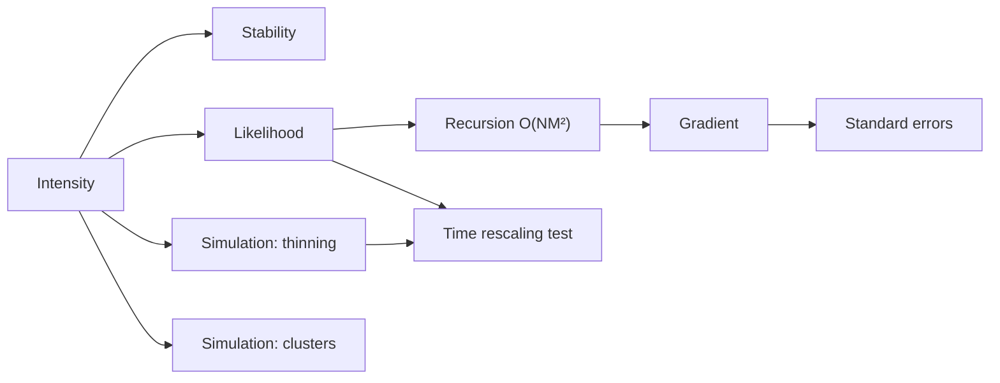

# Specification: mathematics

**Purpose.** The specification the code is built against. Statements are given;
**derivations are yours**, per [the verification rule](../verification-rule.md).
If a formula here disagrees with your derivation, find out which is wrong
before writing any code.

## Map of this document

## 1. The model

There are $M$ event types. Let $N_j$ count events of type $j$. The conditional intensity of type $i$ is

$$\lambda_i(t) = \mu_i + \sum_{j=1}^{M} \int_0^{t^-} \alpha_{ij}\, e^{-\beta_{ij}(t-s)}\, dN_j(s) = \mu_i + \sum_{j}\sum_{t^j_m < t} \alpha_{ij}\, e^{-\beta_{ij}(t - t^j_m)}.$$

Read it as: baseline $\mu_i$, plus a bump of height $\alpha_{ij}$ for every past type-$j$ event, decaying at rate $\beta_{ij}$. The intensity $\lambda_i(t)\,dt$ is the probability of a type-$i$ event in $[t, t+dt)$ given the full past.

## 2. Stability

Integrating the kernel gives the branching matrix

$$\Gamma_{ij} = \int_0^\infty \alpha_{ij}e^{-\beta_{ij}u}\,du = \frac{\alpha_{ij}}{\beta_{ij}}.$$

$\Gamma_{ij}$ is the expected number of type-$i$ children of one type-$j$ event. The process is stationary when the spectral radius $\rho(\Gamma) < 1$, and then the mean intensity vector is

$$\bar\lambda = (I - \Gamma)^{-1}\mu.$$

Two uses: the stationary mean is a **free test** for the simulator (§6), and $\rho(\Gamma)$ is the headline number the fit reports. Indexing is easy to flip: row $i$ is the *target*, column $j$ the *source*. Fix this in the code's type names and never change it.

## 3. Log-likelihood

For events observed on $[0, T]$,

$$\ell(\theta) = \sum_{i=1}^{M}\left[\sum_{k}\log\lambda_i(t^i_k) \;-\; \int_0^T \lambda_i(t)\,dt\right].$$

The compensator has a closed form for exponential kernels:

$$\int_0^T \lambda_i\,dt = \mu_i T + \sum_{j}\sum_{m}\frac{\alpha_{ij}}{\beta_{ij}}\left(1 - e^{-\beta_{ij}(T - t^j_m)}\right).$$

## 4. The recursion that makes it fast

Define $S_{ij}(t) = \sum_{t^j_m < t} e^{-\beta_{ij}(t - t^j_m)}$. Then $\lambda_i(t) = \mu_i + \sum_j \alpha_{ij}S_{ij}(t)$. Merge all events into one time-sorted stream. Between consecutive events at times $\tau_{n-1}<\tau_n$,

$$S_{ij}(\tau_n^-) = e^{-\beta_{ij}(\tau_n - \tau_{n-1})}\,S_{ij}(\tau_{n-1}^+),$$

and an event of type $d$ at $\tau_n$ adds $1$ to $S_{id}$ for every $i$. So the whole likelihood is a single pass over the events.

**Cost.** Each event decays all $M^2$ states, so one evaluation is $O(NM^2)$ time and $O(M^2)$ memory, against $O(N^2M^2)$ for the naive double sum. If $\beta_{ij}=\beta_j$ depends only on the source, $S_{ij}=S_j$ and the cost drops to $O(NM)$. Offer both parameterizations; the shared-decay one is the fast path and a reasonable default for $M\ge 6$.

**Two numerical traps.**

**Time origin.** Epoch seconds near $1.7\times10^9$ use about 31 of float64's 53 mantissa bits, leaving roughly $2^{-22}\approx 2.4\times10^{-7}$ s of resolution. Always subtract the session start before converting to float. Keep integer nanoseconds in storage (see ADR-003).

**Overflow of the likelihood.** $e^{-\beta\Delta}$ underflows harmlessly to 0. $\log\lambda$ is the risk: if $\lambda_i$ rounds to 0 at an event, the term is $-\infty$. Bound $\mu_i>0$ and test this case explicitly.

## 5. Gradient

Differentiating $\ell$ gives, for each parameter, a sum over events of (derivative of $\lambda$) divided by $\lambda$, minus the derivative of the compensator. The pieces are:

- $\partial\ell/\partial\mu_i$ needs only $1/\lambda_i$ at type-$i$ events
- $\partial\ell/\partial\alpha_{ij}$ needs $S_{ij}$ at type-$i$ events
- $\partial\ell/\partial\beta_{ij}$ needs the companion state $D_{ij}(t) = \partial S_{ij}/\partial\beta_{ij} = -\sum_m (t-t^j_m)e^{-\beta_{ij}(t-t^j_m)}$, which has its own one-step recursion

**Derive these three, and the recursion for $D_{ij}$, on paper at gate H1.** Then confirm each against central finite differences. Parameterize in log space ($\mu=e^{a},\ \alpha=e^{b},\ \beta=e^{c}$) so positivity is automatic, and remember the chain rule when you do.

## 6. Simulation, two ways

### Ogata's modified thinning

State: current $S_{ij}$. At time $t$ let $\Lambda^\ast = \sum_i \lambda_i(t^+)$. For an excitation-only process, $\lambda_i$ only decays until the next event, so $\Lambda^\ast$ is a valid upper bound. Loop: draw $\Delta\sim\text{Exp}(\Lambda^\ast)$; advance the state by $\Delta$; accept with probability $\sum_i\lambda_i(t+\Delta)/\Lambda^\ast$; on acceptance choose the type $i$ with probability proportional to $\lambda_i$, add the jump, and reset the bound. On rejection, set $t\leftarrow t+\Delta$ and the bound to the *current* total (still valid, since the intensity has only decayed).

**"Suppressing" channels break this.** With $\alpha_{ij}<0$, intensity can **rise** between events as an inhibiting bump fades, and the true rate is $\max(0,\cdot)$. The bound must then use only the positive contributions, $\sum_i\big[\mu_i+\sum_j\alpha_{ij}^{+}S_{ij}\big]$, and the likelihood is not differentiable where the max kicks in. That is why v0.1 restricts to $\alpha\ge0$.

### Cluster (branching) representation

Immigrants arrive as a Poisson process of rate $\mu_i$. Every event of type $j$ independently produces a Poisson($\Gamma_{ij}$) number of type-$i$ children, each delayed by an independent Exp($\beta_{ij}$) time. Recurse until no children are left. This uses **none** of the thinning machinery, which is exactly why it is the second simulator required by [the verification rule](../verification-rule.md). Truncate at $T$; note that clusters started before $0$ are missing, so discard a burn-in or start the process from its stationary state.

## 7. Standard errors

At the maximum, the observed information is minus the Hessian of $\ell$. Standard errors are the square roots of the diagonal of its inverse. Start with a numerical Hessian from the analytic gradient (differences of gradients, so one order better than differencing $\ell$ twice); promote to analytic only if profiling says it matters. When the Hessian is near-singular, **report that** instead of a number: it means the $\alpha$–$\beta$ ridge, which is the subject of the validation study.

## 8. Goodness of fit: time rescaling

If the model is right, the transformed gaps

$$\tau^i_k = \int_{t^i_{k-1}}^{t^i_k} \lambda_i(t)\,dt$$

are independent Exp(1) variables (Papangelou's time-change theorem). So the diagnostics are a Q–Q plot against Exp(1) for each type and a Kolmogorov–Smirnov test, plus a check of independence (lag-1 correlation of the $\tau$'s). Ship this in the library: it is the single most useful thing a retail user can run on their own fit.

## References to read

- Hawkes (1971), the original paper
- Ozaki (1979), the exponential-kernel likelihood recursion
- Ogata (1978) for asymptotics of the MLE; Ogata (1981) for thinning
- Laub, Taimre & Pollett (2015), *Hawkes Processes*, a short tutorial that fits this note almost exactly
- Bacry, Mastromatteo & Muzy (2015), *Hawkes processes in finance*
- Filimonov & Sornette (2012) and Hardiman, Bercot & Bouchaud (2013) for the branching-ratio-near-one debate

**Verify before citing.** These are from memory. At H0, open each one, confirm title, year and what it actually claims, and record that in the literature log. A citation you have not opened is the same error as a number you have not computed.

## Related documents

- [Verification rule](../verification-rule.md)
- [Roadmap](../ROADMAP.md)
- [ADR-002: parameterization and index conventions](../adr/ADR-002-parameterization.md)
- [ADR-003: event memory layout](../adr/ADR-003-memory-layout.md)
